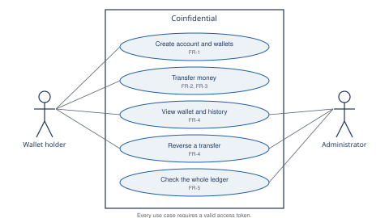
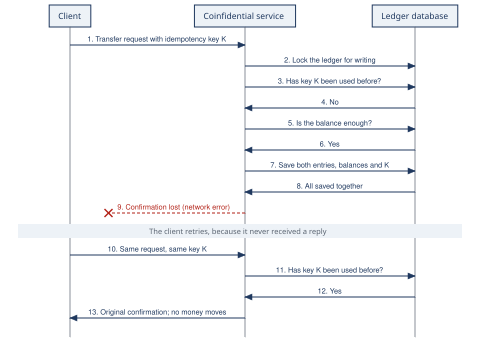

# Software Requirements Specification for Coinfidential

Version 1.0 approved

Prepared by Aditya Bhat (BT2024035), Subhadeep Das (BT2024219), Hemakshi Jadeja (BT2024002) and Hardh Kava (BT2024041)

Coinfidential Team, Software Engineering, Semester 5

November 9, 2026

Repository: [github.com/hemakshijadeja/Coinfidential](https://github.com/hemakshijadeja/Coinfidential)

## Revision History

| Name | Date | Reason For Changes | Version |
| --- | --- | --- | --- |
| Aditya Bhat | 2026-11-09 | Initial SRS, restructured to the IEEE-format template | 1.0 draft |
| Hemakshi Jadeja | 2026-11-09 | Formal review and approval in PR #5 | 1.0 approved |
| Aditya Bhat | 2026-11-09 | Added business rules, appendices and the PR review record | 1.0 approved |
| Aditya Bhat | 2026-11-15 | Simplified the language, removed API definitions, and added use case and sequence diagrams, following TA feedback | 1.0 approved |

## 1. Introduction

### 1.1 Purpose

This document describes the requirements for version 1.0 of Coinfidential, a digital wallet backend that keeps a reliable record of money. It explains what the system must do, in plain language. How the system does it will be decided in the Stage 2 design documents. This SRS is the Stage 1 deliverable required by SE-1.

At present, only a basic health check is built. Everything else in this document is planned.

### 1.2 Document Conventions

This SRS follows Karl E. Wiegers' IEEE-format SRS template. Appendix A explains the terms used, and Appendix C lists the decisions still to be made.

- **Requirement IDs.** `FR` marks functional requirements, `NFR` non-functional requirements, `SK` agent skills, `TQ` testing and quality, `SE` software engineering, and `SB` the Second Brain. Security Testing is a requirement in the project brief that has no ID.
- **"Shall" and "should".** "Shall" means the requirement is mandatory. "Should" means it is recommended.
- **Priority.** All five features are High priority, because the project brief requires each one. Detailed requirements share the priority of their feature.
- **Research links.** Text such as `[[note-name]]` refers to a research note in the team's `brain/` knowledge base.

| ID series | Where it comes from |
| --- | --- |
| FR-1 to FR-5, TQ-1 to TQ-6, Security Testing | The project brief, `Financial_Ledger.pdf` |
| SB-1 to SB-6, SE-1 to SE-7, TQ-7, TQ-8 | The course document, `SDLC_and_Workflow.pdf` |
| NFR-1 to NFR-8, SK-1 to SK-5 | Defined by the team in this SRS, because the course documents ask for them without listing them |

### 1.3 Intended Audience and Reading Suggestions

This SRS is for course reviewers, the development team, testers and the people who write the team's agent skills. Section 2 gives an overview of the product, Section 4 describes its features, Section 5 its quality requirements, and Section 6 the course-specific requirements. All readers should start with Sections 1.4 and 2.

### 1.4 Product Scope

**The problem: the Vanishing Money Glitch.** In poorly designed systems, two payments made at the same moment can overwrite each other's balance updates, and a payment retried after a network error can be charged twice. Either way, money goes missing or is taken twice. The team's research reproduced both problems ([[race-conditions-and-optimistic-locking]], [[idempotent-api-design-patterns]]).

**The solution: a mathematically sound double-entry backend.** Coinfidential keeps every movement of money in a double-entry ledger, where each amount taken from one place is recorded as added to another ([[double-entry-bookkeeping-principles]]). As a result:

- Money cannot appear or disappear, because every transaction balances.
- Retrying a payment never charges it twice.
- Payments made at the same moment cannot corrupt a balance.
- Past records are never changed, and mistakes are corrected with new records.
- An administrator can check at any time that all the records add up.

**In scope:** creating user accounts and wallets, transferring money between wallets, reversing transfers, viewing wallets and their history, and checking the ledger.

**Out of scope:** currency conversion, connections to banks or real payment networks, a graphical user interface, and user registration and login.

### 1.5 References

- Project repository: [github.com/hemakshijadeja/Coinfidential](https://github.com/hemakshijadeja/Coinfidential)
- Project brief: `Financial_Ledger.pdf`. Course document: `SDLC_and_Workflow.pdf`. Neither is stored in the repository.
- Research notes in `brain/`: [[double-entry-bookkeeping-principles]], [[integer-minor-units-money-math]], [[rest-api-error-handling-and-status-codes]], [[sqlite-acid-and-wal-concurrency]], [[race-conditions-and-optimistic-locking]], [[provider-interface-isolation]], [[idempotent-api-design-patterns]], [[immutable-audit-trail-and-reversals]], [[ledger-reconciliation-algorithms]], [[financial-api-security-and-validation]] and [[agent-skills-and-second-brain-architecture]].
- Team records: [[stage1-ai-session-setup]] and [[stage1-review-retrospective]].
- External standards: RFC 6750 (bearer tokens), RFC 9110 (HTTP), the OWASP API Security Top 10, the SQLite documentation, and the [Agent Skills specification](https://agentskills.io/specification).

## 2. Overall Description

### 2.1 Product Perspective

Coinfidential is a new, standalone backend service. Other programs talk to it over the internet. It does not connect to banks.

```
Client programs and testing tools
        |  requests over HTTPS
        v
Coinfidential service    checks who is calling, and checks every input
        |
        v
Ledger rules             transfers, reversals and ledger checks
        |
        v
Database                 SQLite, holding accounts, wallets and the ledger
```

### 2.2 Product Functions

Figure 1 shows what each type of user can do, and which feature (FR) each use case belongs to. Wallet holders manage their own wallets and money, and administrators can also reverse transfers and check the whole ledger.



### 2.3 User Classes and Characteristics

| User class | Description | Access |
| --- | --- | --- |
| Wallet holder | A person, through a client program, using their own token | Their own accounts and wallets |
| Administrator | A trusted operator with an administrator token | Ledger checks, reversals, and viewing all wallets |
| Development team | The four team members and their agent skills | Test copies of the system only |

### 2.4 Operating Environment

The service runs on a single computer with Python 3.12 and the SQLite database. The team develops on Windows, and the automated checks run on Linux in GitHub Actions.

### 2.5 Design and Implementation Constraints

- **Database.** The system shall use SQLite in WAL mode (`PRAGMA journal_mode=WAL;`), which lets the ledger be read while payments are being made ([[sqlite-acid-and-wal-concurrency]]).
- **Locking.** Each payment shall lock the database for writing (`BEGIN IMMEDIATE`) before checking the balance, so two payments cannot both use the same money.
- **Whole numbers for money.** All amounts shall be stored as whole numbers of the smallest currency unit, such as cents or paise. For example, 12.34 rupees is stored as 1234 paise. Decimal fractions are not used, because computers cannot store them exactly: in testing, adding 0.1 ten times gave 0.9999999999999999 instead of 1 ([[integer-minor-units-money-math]]).
- **Amount limit.** A single transaction shall be between 1 and 10^12 (one trillion) minor units.
- **Separate storage layer.** The database shall sit behind a separate storage layer, so that tests can use a fresh database (SE-6).
- **Process.** Every change is reviewed by a person before it is merged, and important design decisions are recorded as ADRs (SE-3).

### 2.6 User Documentation

The team shall provide a user guide for the API and developer API documentation, such as OpenAPI, as SE-7 requires. The repository's `README.md` explains how to set up the project and run its checks.

### 2.7 Assumptions and Dependencies

**Assumptions:** the service runs on one computer, and every account, wallet and transaction is given a unique ID by the system.

**Dependencies:** Python, the FastAPI web framework and SQLite, with versions fixed in `requirements.txt`.

**Decisions.** The brief leaves some points open. The team has decided these:

| ID | Question | Decision |
| --- | --- | --- |
| OD-1 | Do users need to identify themselves? | Yes. Every request must carry an access token |
| OD-2 | Who can run the ledger check? | Only administrators |
| OD-3 | How does a new wallet get its starting money? | From a system account for that currency, recorded like any other transfer |
| OD-5 | What is the largest allowed amount? | 10^12 minor units per transaction |
| OD-6 | If a payment fails for lack of funds, can it be retried with the same key? | No. A new attempt needs a new key |
| OD-7 | How long are payment keys kept? | Permanently, so a retry can never charge twice |
| OD-8 | Can a transfer be reversed after the money was spent? | No |
| OD-10 | What does "idempotency key hashing" in TQ-1 mean? | Storing a fingerprint of each request's contents |
| OD-12 | Does SE-6 apply to the database? | Yes |
| OD-13 | How do users get tokens? | An operator issues them, as registration is out of scope |

Decisions OD-4, OD-9 and OD-11 are still open, and are listed in Appendix C.

## 3. External Interface Requirements

### 3.1 User Interfaces

There is no graphical user interface. People use the service through API testing tools such as Postman, Bruno or cURL.

### 3.2 Hardware Interfaces

There are no hardware interfaces.

### 3.3 Software Interfaces

Coinfidential offers a REST API that exchanges data as JSON. It provides the operations shown in Figure 1, plus a health check that any user with a valid token can call.

Every error reply shall use one consistent, structured format, explaining what went wrong without exposing internal details ([[rest-api-error-handling-and-status-codes]]). The exact request and response formats will be defined in the Stage 2 API documentation.

The service shall store its data in SQLite through a separate storage layer, so that the rest of the system never works with the database directly. This lets every automated test use its own fresh database (SE-6, [[provider-interface-isolation]]).

### 3.4 Communications Interfaces

The service communicates over HTTP. Because requests carry access tokens, all traffic outside the developer's own computer shall be encrypted with HTTPS, as RFC 6750 requires. Tokens shall be sent only in the request's `Authorization` header, never in a web address.

## 4. System Features

### 4.1 FR-1: Wallet Initialization

#### 4.1.1 Description and Priority

From the brief: "Create user accounts with distinct currency wallets. Every balance is backed by double-entry ledger entries (every credit must equal a debit)."

A user creates an account holding one or more wallets, each in a different currency. A wallet's balance is never stored on its own: every amount in it is backed by matching ledger records. Research: [[double-entry-bookkeeping-principles]].

**Priority:** High.

#### 4.1.2 Stimulus/Response Sequences

| User action | System response |
| --- | --- |
| Creates an account with valid details | Creates the account and its wallets |
| Uses the same currency twice, or an invalid starting balance | Rejects the request and creates nothing |
| Views another user's wallet | Refuses access |

#### 4.1.3 Functional Requirements

**FR-1.1** The system shall create an account and all its wallets together, or not at all.

**FR-1.2** A starting balance shall be recorded as money moving from the system account for that currency, so that the ledger always balances.

**Acceptance criteria:**

1. Creating an account with 100,000 paise in INR and nothing in USD creates two wallets, with exactly two matching ledger records for the INR amount.
2. Repeated currencies, or starting balances of -1, 10.5, "100" or true, are rejected and nothing is created.
3. Requests without a valid token are rejected.

### 4.2 FR-2: Idempotent Transfers

#### 4.2.1 Description and Priority

From the brief: "Transfer funds between two wallets. The endpoint must require an idempotency key (header) to ensure retried network requests never double-charge an account."

An idempotency key is a unique label the client attaches to each payment. If the client sends the same payment again with the same key, for example after a network error, the system recognizes it and does not charge twice. Research: [[idempotent-api-design-patterns]].

**Priority:** High.

#### 4.2.2 Stimulus/Response Sequences

Figure 2 shows a transfer whose confirmation is lost to a network error, and the client's retry. Because the key is recognized, the retry gets the original confirmation and no money moves twice. The system also rejects, without moving any money, a transfer with no key, a key reused for a different transfer, a transfer without enough money, and a transfer from someone else's wallet.



#### 4.2.3 Functional Requirements

**FR-2.1** Every transfer request shall include an idempotency key.

**FR-2.2** The system shall record the transfer, update both balances and remember the key all at once, so that a crash part-way leaves no partial change.

**FR-2.3** A repeated request with the same key and contents shall never move money again.

**FR-2.4** Users shall only be able to send money from wallets they own.

**FR-2.5** Negative amounts shall be rejected. In testing, a transfer of -500 would otherwise have moved money in the wrong direction without being detected ([[financial-api-security-and-validation]]).

**Acceptance criteria:**

1. A valid transfer moves the exact amount and creates two matching ledger records.
2. Sending the same request again returns the same result, and no money moves.
3. Reusing a key with a different amount is rejected.
4. Eight identical requests sent at the same moment result in exactly one transfer.
5. If the system fails before finishing, a retry completes the transfer exactly once.
6. An amount of 10^12 is accepted when funds allow, and any larger amount is rejected.

### 4.3 FR-3: Concurrent Balance Mutability and Race Prevention

#### 4.3.1 Description and Priority

From the brief: "Safely handle multiple simultaneous incoming/outgoing transfer requests on the same wallet without data race conditions or balance corruption."

A race condition happens when two payments both check a balance before either one updates it, so both spend the same money. In the team's tests, eight unprotected payments of 100 from a balance of 100 all succeeded, leaving a balance of -700. Research: [[sqlite-acid-and-wal-concurrency]], [[race-conditions-and-optimistic-locking]].

**Priority:** High.

#### 4.3.2 Stimulus/Response Sequences

| User action | System response |
| --- | --- |
| Several payments are made from one wallet at the same moment | Handles them one at a time, each against the latest balance |
| More payments arrive than the balance can cover | Accepts those it can cover, and rejects the rest |
| The system is too busy to process a payment in time | Asks the client to retry later, and changes nothing |

#### 4.3.3 Functional Requirements

**FR-3.1** The system shall check the balance and make the payment as one step that no other payment can interrupt.

**FR-3.2** A balance shall never go below zero, and no payment shall ever be lost.

**Acceptance criteria:**

1. Eight simultaneous payments of 100 from a balance of 100 result in exactly one success and a final balance of 0, every time in five test runs.
2. Eight simultaneous payments of 10 from a balance of 100 all succeed, leaving 20.
3. No user ever sees an internal database error, and the ledger check passes afterwards.

### 4.4 FR-4: Immutable Audit Trail and Reversal Transactions

#### 4.4.1 Description and Priority

From the brief: "Ledger records cannot be updated or deleted once written. Any corrections or cancellations must be recorded as an explicit reversal transaction."

The ledger is permanent, like a bank statement. To cancel a transfer, the system adds a new reversal that moves the money back, and the original record stays visible. Research: [[immutable-audit-trail-and-reversals]].

**Priority:** High.

#### 4.4.2 Stimulus/Response Sequences

| User action | System response |
| --- | --- |
| The sender or an administrator reverses a transfer | Adds a reversal that moves the money back, and keeps the original |
| Tries to reverse the same transfer twice | Rejects the second reversal |
| Tries to reverse after the recipient has spent the money | Rejects the reversal |
| Anyone tries to edit or delete a ledger record | The record cannot be changed |

#### 4.4.3 Functional Requirements

**FR-4.1** The database itself shall prevent ledger records from being edited or deleted.

**FR-4.2** Corrections shall be made only by adding reversal records, and each transfer can be reversed at most once.

**FR-4.3** The ledger shall be tamper-evident, as the brief requires: any change to a past record shall be detectable.

**Acceptance criteria:**

1. Reversing a transfer of 100 restores both balances, and the original two records remain unchanged.
2. A second reversal of the same transfer is rejected.
3. Attempts to edit or delete ledger records fail, including indirect ways found in research.
4. A direct change to a past record is detected.

### 4.5 FR-5: Ledger Reconciliation Endpoint

#### 4.5.1 Description and Priority

From the brief: "An administrative endpoint that scans ledger entries and verifies that the sum of credits equals debits, and that current wallet balances match the calculated ledger sums."

Reconciliation is an audit: the system adds up the entire ledger and confirms that nothing has gone wrong. Research: [[ledger-reconciliation-algorithms]].

**Priority:** High.

#### 4.5.2 Stimulus/Response Sequences

| User action | System response |
| --- | --- |
| An administrator runs the check on a correct ledger | Reports that everything balances |
| An administrator runs the check on a faulty ledger | Reports what is wrong and where |
| A regular user tries to run the check | Refuses access |

#### 4.5.3 Functional Requirements

**FR-5.1** The check shall confirm that total credits equal total debits, for each currency.

**FR-5.2** The check shall confirm that every wallet's balance matches its ledger records.

**FR-5.3** The check shall see the ledger as it was at a single moment, so payments in progress cannot cause false alarms. In testing, checking without this produced false alarms in 254 of 300 runs.

**FR-5.4** The check should also confirm that each individual transaction balances, and that no record has been tampered with.

**FR-5.5** The check shall only report problems. It shall never change any data.

**Acceptance criteria:**

1. A correct ledger, and an empty one, both pass.
2. A wrongly changed balance, and a transfer missing one of its two records, are both reported.
3. No false alarms occur in 300 checks run while payments are being made.
4. Regular users cannot run the check.

## 5. Other Nonfunctional Requirements

### 5.1 Performance Requirements

No speed targets are set yet, because none can be measured reliably until the system is built (Appendix C). For now, the key requirement is correctness when many requests arrive at once.

| ID | Name | Requirement | How it is measured | Verified by |
| --- | --- | --- | --- | --- |
| NFR-2 | Concurrency and Locking | Payments made at the same moment never corrupt a balance | In 5 runs of 8 simultaneous payments, no balance is overspent and no update is lost | TQ-3, TQ-4 |

### 5.2 Safety Requirements

| ID | Name | Requirement | How it is measured | Verified by |
| --- | --- | --- | --- | --- |
| NFR-1 | ACID Atomicity | Every money movement completes fully, or leaves no trace | When a failure is forced at each step of a payment, nothing changes in any case | TQ-2 |
| NFR-4 | Audit Immutability | Past ledger records never change | Every attempt to edit or delete a record fails, and tampering is detected | TQ-3, TQ-4 |

### 5.3 Security Requirements

| ID | Name | Requirement | How it is measured | Verified by |
| --- | --- | --- | --- | --- |
| NFR-5 | Input Security, Authentication and Negative Amount Prevention | Only authorized users can act, every input is checked, and negative amounts are rejected | Every security test in Section 6.2 passes, and no test causes an internal error | TQ-4, Security Testing |

**Authentication.** Every request shall include an access token in the header `Authorization: Bearer <token>`. Requests without a valid token are rejected. Users can only act on their own wallets, and only administrators can run the ledger check. Tokens shall expire, and shall never be stored in readable form, written to logs or placed in web addresses ([[financial-api-security-and-validation]]).

**Input checks.** Every value sent to the system shall be checked, and anything invalid rejected. Amounts must be whole numbers from 1 to 10^12. The database shall also refuse amounts that are not positive.

**Remaining risk.** Anyone who steals a token can use it until it expires.

### 5.4 Software Quality Attributes

| ID | Name | Requirement | How it is measured | Verified by |
| --- | --- | --- | --- | --- |
| NFR-3 | Minor-Unit Precision | Money is always exact | No decimal fractions are used for money, and one million additions of 1 give exactly 1,000,000 | TQ-1, TQ-6 |
| NFR-6 | CI Test Database Isolation | Tests never share data or touch real data | Every test gets a fresh database, and the tests pass in any order | TQ-5 |
| NFR-7 | Provider Interface Decoupling | Only the storage layer talks to the database | An automated test confirms that no other part of the code uses the database directly | TQ-1, TQ-2 |
| NFR-8 | Structured Error Handling | Errors are clear and safe | Every error uses the same format, and never shows internal details or echoes back the user's input | TQ-3, TQ-4 |

### 5.5 Business Rules

| ID | Rule |
| --- | --- |
| BR-1 | Every balance is backed by ledger records, and every credit has an equal debit |
| BR-2 | Only the system accounts that fund new wallets may have a negative balance |
| BR-3 | A transfer stays in one currency |
| BR-4 | Only a wallet's owner may send money from it |
| BR-5 | A single transaction is between 1 and 10^12 minor units |
| BR-6 | One idempotency key gives one outcome, even if that outcome is a rejection |
| BR-7 | Ledger records are never changed, and corrections are made only by reversal |
| BR-8 | A transfer can be reversed once, by its sender or an administrator |
| BR-9 | A reversal is refused if the recipient no longer has the money |
| BR-10 | Only administrators may run the ledger check, which never changes data |

## 6. Other Requirements

This section covers the course-specific requirements: agent skills, testing, skill evaluation and traceability.

### 6.1 Agent Skill Requirements (SK-1 to SK-5)

Agent skills are written instructions that let an AI assistant carry out a task for the team in a repeatable way. Each skill follows the Agent Skills format, must cite at least one research note (SB-3), and must be evaluated before its stage is submitted (TQ-7). Research: [[agent-skills-and-second-brain-architecture]].

| ID | Skill | What it does | Due | Status | Cited notes (SB-3) |
| --- | --- | --- | --- | --- | --- |
| SK-1 | `brain-ingest` | Turns new research into a linked note in the knowledge base, and updates its index and log | Stage 1 | Built | [[double-entry-bookkeeping-principles]], [[stage1-ai-session-setup]] |
| SK-2 | `brain-refine` | Reorganizes notes into the right folders, merges duplicates and fixes broken links | Stage 2 | Not started | [[stage1-review-retrospective]] |
| SK-3 | `brain-query` | Answers questions and drafts documents, such as ADRs, citing the notes it used | Stage 2 | Not started | [[ledger-reconciliation-algorithms]] |
| SK-4 | `local-check` | "Confirm that the project works on a team member's machine": builds it, runs the tests, starts the server and calls it, then reports each step | Stage 2 | Not started | [[provider-interface-isolation]] |
| SK-5 | `simulate-transfer` | "Run a complete product workflow and verify ledger consistency": creates two wallets, transfers money, tests simultaneous payments, then runs the ledger check | Stage 3 | Not started | [[race-conditions-and-optimistic-locking]], [[idempotent-api-design-patterns]] |

Each skill shall work only on test data, and its results shall be checked by the team's validation scripts.

### 6.2 Testing and Quality (TQ-1 to TQ-8)

The product tests below are planned, because the features are not built yet. The automated checks for the repository already run on every change.

| ID | Requirement, from the course documents | How it will be verified | Status |
| --- | --- | --- | --- |
| TQ-1 | Unit tests for accounting calculations, ledger balance assertions, and idempotency key hashing | Small tests of the money rules and request fingerprints | Planned |
| TQ-2 | Integration tests verifying database transactions and database rollback behavior on simulated transfer failures | Force a failure at each step, and confirm nothing changed | Planned |
| TQ-3 | System (end-to-end) tests for each of FR-1 to FR-5 | Test each feature's acceptance criteria through the API | Planned |
| TQ-4 | Negative tests: negative balance attempts, insufficient funds, invalid idempotency payloads, malformed IDs, and simultaneous concurrent transfers (proving race safety) | The security tests below, plus simultaneous payment tests | Planned |
| TQ-5 | CI tests shall run against an isolated test database (e.g., an in-memory or fresh local database instance) on every push | Give each test a fresh database | Automated checks run, database setup planned |
| TQ-6 | The system shall prevent floating-point rounding errors. Test that monetary amounts are strictly handled using integer minor units (e.g., cents/paise) or exact decimal types | Reject fractional amounts, and test repeated balance updates | Planned |
| TQ-7 | Skill evaluations shall run before each stage submission. Record results in the test documentation | Section 6.3 records Stage 1 | Stage 1 partly done |
| TQ-8 | Maintain and update tests as the system changes. Each significant defect gets a regression test | A defect log from Stage 3 | Planned |
| Security Testing | Input validation (all API parameters), Negative amount prevention (preventing users from sending negative values to inflate balances) | The security tests below | Planned |

**Security tests.** The system must reject, without any internal error or change to balances:

- requests with a missing, invalid or expired token, or acting on someone else's wallet;
- amounts that are negative, zero, fractional, text, empty or above the limit;
- malformed wallet IDs, including text designed to attack the database;
- transfers from a wallet to itself;
- missing or invalid idempotency keys;
- unexpected extra fields in a request.

### 6.3 Stage 1 Skill Evaluation (TQ-7)

The team evaluated `brain-ingest` (SK-1) on 2026-11-09 with the script `scripts/evaluate_brain_ingest.py`. It checked the 11 research notes that the skill produced against 12 rules, such as having the required details, following the note template, linking related notes, and being listed in the index and log.

| Run | Result |
| --- | --- |
| First run | 131 of 132 checks passed. One real mistake was found: a note mentioned requirement SE-3 without listing it. The note was fixed |
| Second run | 132 of 132 checks passed |
| Validator test | All 20 deliberately broken test cases were handled as expected, and 3 known limits of the validator were recorded |
| Official skill checker | `brain-ingest` passed the reference validator for the Agent Skills format |

**Verdict: partly met.** The skill's notes follow its rules, but the evaluation checks format rather than accuracy, and it has not yet compared results with and without the skill, as the Agent Skills guidance recommends. That comparison is still to be done.

### 6.4 Traceability Matrix and Task Breakdown (SE-4, SE-5)

#### 6.4.1 Four-Stage Roadmap (SE-4)

| Stage | Main deliverables | Status |
| --- | --- | --- |
| 1: Requirements | SRS, the knowledge base with at least 10 research notes, `AGENTS.md`, and the repository with automated checks | Done, except the skill comparison |
| 2: Design | Architecture and design documents, diagrams, the `brain-refine` and `brain-query` skills, and a first `local-check` | Not started |
| 3: Testing | Test plan and results, the `simulate-transfer` skill, and a defect log | Not started |
| 4: Review | Live demonstration of all features and skills, and a final release | Not started |

The course sets no separate build stage, so the team plans to build FR-1 to FR-5 during Stage 2 and early Stage 3. Dates are still to be set (Appendix C).

#### 6.4.2 Four-Member Task Allocation

Stage 1 work comes from the project history. Later owners are proposals for the team to confirm.

| Member | Stage 1 (done) | Stage 2 (proposed) | Stage 3 (proposed) |
| --- | --- | --- | --- |
| Hemakshi Jadeja | Repository, automated checks, `AGENTS.md`, `brain-ingest`, 3 research notes | Architecture, diagrams, FR-1 | End-to-end tests |
| Aditya Bhat | 3 research notes, SRS | Database design, storage layer, FR-3, `local-check` | Simultaneous payment and database tests |
| Subhadeep Das | 3 research notes | Design decisions, FR-2, FR-4, `brain-refine` | Unit tests, `simulate-transfer` |
| Hardh Kava | 2 research notes, Stage 1 review | Security decisions, sign-in, FR-5, `brain-query` | Security tests, skill evaluations |

#### 6.4.3 Traceability Matrix (SE-5)

This matrix links each requirement to its GitHub issue, pull request (PR), tests, skills and research. Each group of requirements has one tracking issue: #7 (FR), #8 (NFR), #9 (SK), #10 (TQ and Security Testing), #11 (SE) and #12 (SB). "Planned" means the work has not started.

| Requirement ID | GitHub Issue | PR | Test ID (TQ-*) | Skill (SK-*) | Brain Note |
| --- | --- | --- | --- | --- | --- |
| FR-1 | #7 | #1 research | TQ-1, TQ-3, TQ-4, TQ-6 | SK-5 | [[double-entry-bookkeeping-principles]] |
| FR-2 | #7 | #3 research | TQ-1, TQ-2, TQ-3, TQ-4 | SK-5 | [[idempotent-api-design-patterns]] |
| FR-3 | #7 | #2 research | TQ-2, TQ-3, TQ-4 | SK-5 | [[race-conditions-and-optimistic-locking]] |
| FR-4 | #7 | #3 research | TQ-2, TQ-3, TQ-4 | SK-4 | [[immutable-audit-trail-and-reversals]] |
| FR-5 | #7 | #3 research | TQ-1, TQ-3 | SK-5 | [[ledger-reconciliation-algorithms]] |
| NFR-1 | #8 | #2 research | TQ-2 | SK-4 | [[sqlite-acid-and-wal-concurrency]] |
| NFR-2 | #8 | #2 research | TQ-3, TQ-4 | SK-5 | [[race-conditions-and-optimistic-locking]] |
| NFR-3 | #8 | #1 research | TQ-1, TQ-6 | SK-4 | [[integer-minor-units-money-math]] |
| NFR-4 | #8 | #3 research | TQ-3, TQ-4 | SK-4 | [[immutable-audit-trail-and-reversals]] |
| NFR-5 | #8 | #4 research | TQ-4 | SK-4 | [[financial-api-security-and-validation]] |
| NFR-6 | #8 | #2 research | TQ-5 | SK-4 | [[provider-interface-isolation]] |
| NFR-7 | #8 | #2 research | TQ-1, TQ-2 | SK-4 | [[provider-interface-isolation]] |
| NFR-8 | #8 | #1 research | TQ-3, TQ-4 | SK-4 | [[rest-api-error-handling-and-status-codes]] |
| SK-1 | #9 | #1 built | TQ-7 | SK-1 | [[agent-skills-and-second-brain-architecture]] |
| SK-2 | #9 | Planned | TQ-7 | SK-2 | [[agent-skills-and-second-brain-architecture]] |
| SK-3 | #9 | Planned | TQ-7 | SK-3 | [[agent-skills-and-second-brain-architecture]] |
| SK-4 | #9 | Planned | TQ-7 | SK-4 | [[agent-skills-and-second-brain-architecture]] |
| SK-5 | #9 | Planned | TQ-7 | SK-5 | [[ledger-reconciliation-algorithms]] |
| TQ-1 | #10 | Planned | TQ-1 | SK-4 | [[idempotent-api-design-patterns]] |
| TQ-2 | #10 | Planned | TQ-2 | SK-4 | [[sqlite-acid-and-wal-concurrency]] |
| TQ-3 | #10 | Planned | TQ-3 | SK-4, SK-5 | [[rest-api-error-handling-and-status-codes]] |
| TQ-4 | #10 | Planned | TQ-4 | SK-4, SK-5 | [[financial-api-security-and-validation]] |
| TQ-5 | #10 | #1 checks | TQ-5 | SK-4 | [[provider-interface-isolation]] |
| TQ-6 | #10 | Planned | TQ-6 | SK-4 | [[integer-minor-units-money-math]] |
| TQ-7 | #10 | #5, #6 | TQ-7 | SK-1 | [[agent-skills-and-second-brain-architecture]] |
| TQ-8 | #10 | Planned | TQ-8 | SK-4 | [[stage1-review-retrospective]] |
| Security Testing | #10 | #4 research | TQ-4 | SK-4 | [[financial-api-security-and-validation]] |
| SE-1 | #11 | #5, #6 | Not applicable | SK-3 | [[stage1-review-retrospective]] |
| SE-2 | #11 | Planned | Not applicable | SK-3 | [[stage1-review-retrospective]] |
| SE-3 | #11 | Planned | Not applicable | SK-3 | [[stage1-review-retrospective]] |
| SE-4 | #11 | #4, #5, #6 | Not applicable | None | [[stage1-review-retrospective]] |
| SE-5 | #11 | #5, #6 | Not applicable | None | [[stage1-review-retrospective]] |
| SE-6 | #11 | #2 research | TQ-1, TQ-2 | SK-4 | [[provider-interface-isolation]] |
| SE-7 | #11 | Planned | TQ-3 | None | [[rest-api-error-handling-and-status-codes]] |
| SB-1 | #12 | #1 | TQ-7 | SK-1, SK-2 | [[agent-skills-and-second-brain-architecture]] |
| SB-2 | #12 | #1, #4 | Not applicable | None | [[stage1-review-retrospective]] |
| SB-3 | #12 | #1 | TQ-7 | SK-1 | [[agent-skills-and-second-brain-architecture]] |
| SB-4 | #12 | #1 | Not applicable | None | [[stage1-ai-session-setup]] |
| SB-5 | #12 | #1 to #6 | Not applicable | None | [[stage1-review-retrospective]] |
| SB-6 | #12 | #1 to #4 | Not applicable | None | [[stage1-review-retrospective]] |

#### 6.4.4 Known Gaps

**Pull request reviews.** PRs #1 to #4 were merged on 2026-11-08 without a recorded review. On 2026-11-09, team members added approval comments to them, and PR #5 was formally reviewed and approved before merging. From now on, every PR needs a review before it is merged.

| Gap | Next step |
| --- | --- |
| Issues track whole groups of requirements, not single requirements | Split them, or add a checklist item per requirement, as work starts in Stage 2 |
| Skill comparison not yet done (TQ-7) | Compare results with and without the skill |
| Only the health check is built | Build the features under the Section 6.4.1 plan |

## Appendix A: Glossary

| Term | Meaning |
| --- | --- |
| ACID | The four guarantees of a reliable database: Atomicity, Consistency, Isolation and Durability |
| ADR | Architecture Decision Record, a short document explaining a design decision |
| API | Application Programming Interface, the way other programs talk to this service |
| Credit, debit | The two sides of every ledger entry: money added to one place and taken from another |
| Double-entry | Recording every movement of money twice, as a debit and an equal credit |
| Idempotency key | A unique label on a request, so that sending it again does not repeat the action |
| Ledger | The permanent record of every movement of money |
| Minor unit | The smallest unit of a currency, such as a cent or paisa |
| Race condition | An error caused by two actions happening at the same moment and interfering |
| Reconciliation | Checking that all the ledger records add up correctly |
| Reversal | A new record that undoes an earlier transfer, leaving the original in place |
| SRS | Software Requirements Specification |
| Token | A secret code that identifies a user to the system |
| WAL | Write-Ahead Logging, a SQLite setting that lets reads and writes happen together |

## Appendix B: Analysis Models

This SRS includes three models: the overview diagram in Section 2.1, the use case diagram in Figure 1 (Section 2.2), and the transfer sequence diagram in Figure 2 (Section 4.2.2). Detailed design diagrams, such as the database design, are Stage 2 deliverables (SE-2).

## Appendix C: To Be Determined List

| No. | To be decided | Decided by |
| --- | --- | --- |
| 1 | Which currencies are supported (OD-4) | Stage 2 decision record |
| 2 | Whether partial reversals are allowed (OD-9) | Stage 2 decision record |
| 3 | How tamper detection will work (OD-11) | Stage 2 decision record |
| 4 | Token format and how long tokens last | Stage 2 decision record |
| 5 | Exact request and response formats | Stage 2 API documentation |
| 6 | Speed targets | Stage 3 measurements |
| 7 | Dates for each stage | The team |
