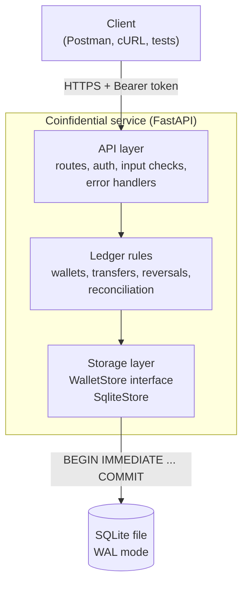

# Coinfidential Architecture

- **Author:** Hemakshi
- **Stage:** 2 (Design)
- **Based on:** `SRS_Stage1_Submission.pdf` and the ADRs in [docs/adr/](adr/)

This document explains how Coinfidential will be built. Right now only `GET /health` exists in `app/main.py`, so everything below is the plan for Stage 2 and Stage 3.

## 1. Overview

Coinfidential is one FastAPI service that runs on one computer and stores everything in one SQLite file. We split the code into four layers. Each layer only talks to the layer right below it.

| Layer | What it does | Does not do |
| --- | --- | --- |
| **API** | Receives HTTP requests, checks the token, checks the input with Pydantic, calls the ledger rules and turns the result (or error) into JSON. | Money logic or SQL. |
| **Ledger rules** | Wallet creation, transfers, idempotency, reversals and the reconciliation check. All the business rules (BR-1 to BR-10) live here. | HTTP or SQL. |
| **Storage layer** | A small interface (`WalletStore`) and one class that implements it (`SqliteStore`). It holds all the SQL and opens transactions. | Business decisions. |
| **SQLite** | The database file in WAL mode, with triggers that block edits and deletes on the ledger. | Anything else. |

The main reason for the split is SE-6 and NFR-7: only the storage layer touches the database, so tests can give the service a fresh database every time (TQ-5). See [ADR-0006](adr/0006-storage-provider-interface.md).

## 2. Component diagram



## 3. The layers in a bit more detail

### 3.1 API layer

- Every request needs `Authorization: Bearer <token>` (NFR-5). Tokens are random strings, and we only store their SHA-256 hash with the user, role and expiry. User tokens last 24 hours and admin tokens last 1 hour ([ADR-0005](adr/0005-token-format-and-lifetime.md)).
- Pydantic models check the input. Amounts must be whole numbers from 1 to 10^12, so `-1`, `10.5`, `"100"` and `true` are all rejected (TQ-6).
- Transfers must send an `Idempotency-Key` header (FR-2).
- The reconciliation endpoint needs an `admin` token (FR-5).

### 3.2 Ledger rules

- **Money** is always an integer in minor units (paise or cents). Only INR and USD are allowed, both with 2 decimal places ([ADR-0001](adr/0001-supported-currencies.md)).
- **Double-entry:** every transfer writes a debit and an equal credit. New wallets get their starting money from a system account for that currency (FR-1.2).
- **Idempotency:** we save the key with a hash of the request. Same key and same request returns the saved response. Same key with a different request is rejected (FR-2).
- **Reversals** move back the full amount, only once. No partial reversals ([ADR-0002](adr/0002-no-partial-reversals.md)).
- **Reconciliation** checks debits equal credits per currency, wallet balances match the ledger, and the hash chain is not broken. It never changes data (FR-5).

### 3.3 Storage layer

- `WalletStore` is a Python `Protocol`. The ledger rules only use this, so they never contain SQL.
- `write_transaction()` runs `BEGIN IMMEDIATE`, then `COMMIT` if everything worked or `ROLLBACK` if there was an exception. The idempotency check, balance check, ledger entries and balance updates all happen inside it ([ADR-0004](adr/0004-begin-immediate-locking.md)).
- Each request gets its own connection with `busy_timeout`, `foreign_keys=ON` and `synchronous=FULL`.
- SQLite errors are turned into our own errors (for example `StoreBusyError`) here, so the layers above never see a raw `sqlite3` error.
- FastAPI gets the store through a dependency, so tests swap it with `app.dependency_overrides`.

### 3.4 SQLite

- `PRAGMA journal_mode=WAL` so the ledger can be read while transfers are running.
- Triggers block `UPDATE` and `DELETE` on ledger entries, with `PRAGMA recursive_triggers=ON` so `INSERT OR REPLACE` is blocked too (FR-4.1).
- Each ledger entry stores `hash = SHA-256(previous hash + its own fields)` so tampering can be detected ([ADR-0003](adr/0003-tamper-detection.md)).
- A `CHECK` constraint makes sure amounts are positive.

## 4. Folder layout (planned)

```
app/
  main.py              creates the FastAPI app, adds routers and error handlers
  errors.py            our error classes and the error handlers
  api/
    auth.py            reads and checks the Bearer token
    schemas.py         Pydantic request and response models
    wallets.py         FR-1 routes
    transfers.py       FR-2, FR-3 and FR-4 routes
    reconcile.py       FR-5 route (admin only)
  ledger/
    wallets.py         create account and wallets
    transfers.py       transfers and idempotency
    reversals.py       full reversals
    reconcile.py       reconciliation check
  storage/
    base.py            WalletStore Protocol
    sqlite_store.py    SqliteStore, the only file with SQL
    schema.sql         tables, triggers and constraints
tests/
  unit/                money rules, request hashing (TQ-1)
  integration/         rollback and race tests on a real file DB (TQ-2, TQ-4)
  e2e/                 one test file per FR through the API (TQ-3)
  conftest.py          gives each test a fresh database (TQ-5)
```

The rule to remember: **only `app/storage/` imports `sqlite3`.** We plan a test that checks this (NFR-7).

## 5. How errors are returned

The SRS says every error must use the same format and must never show internal details or echo back what the user sent (NFR-8). FastAPI's default errors come in three different shapes and echo the input, so we will add our own handlers for validation errors, `HTTPException` and unhandled exceptions.

Every error will look like this:

```json
{
  "error": {
    "code": "insufficient_funds",
    "message": "The wallet does not have enough money for this transfer."
  }
}
```

- `code` is a fixed string that tests and clients can check.
- `message` is a short sentence for people. It never includes stack traces, SQL or tokens.

How an error travels up the layers:

1. The storage layer turns SQLite errors into our own errors (like `StoreBusyError`).
2. The ledger rules raise our own errors (like `InsufficientFunds`). The transaction is rolled back, so nothing changes.
3. The API layer's handlers turn each error class into a status code and the JSON body above.

Planned status codes (from the brain note on error handling):

| Situation | Status |
| --- | --- |
| Transfer created | `201` |
| Retry with same key and same request | The original response again |
| Missing or invalid token | `401` |
| Wallet belongs to someone else, or non-admin calls reconciliation | `403` |
| Wallet not found | `404` |
| Missing idempotency key | `400` |
| Bad amount, bad wallet ID or extra fields | `422` |
| Same idempotency key with a different request | `422` |
| Not enough money, or transfer already reversed | `409` |
| Database too busy (`busy_timeout` ran out) | `503` (not final, see ADR-0004) |
| Anything unexpected | `500` with a generic message |

A reconciliation that finds a problem still returns `200`, because the check itself worked. The problems are listed in the response body.

## 6. Still open

- `409` or `422` for insufficient funds. We picked `409` above, but it is not in an ADR yet.
- Whether to use the full RFC 9457 "problem details" format instead of our simpler one.
- The `busy_timeout` value and whether `503` is the right status for it.
- How FastAPI should manage connections (for example whether `check_same_thread=False` is needed).
