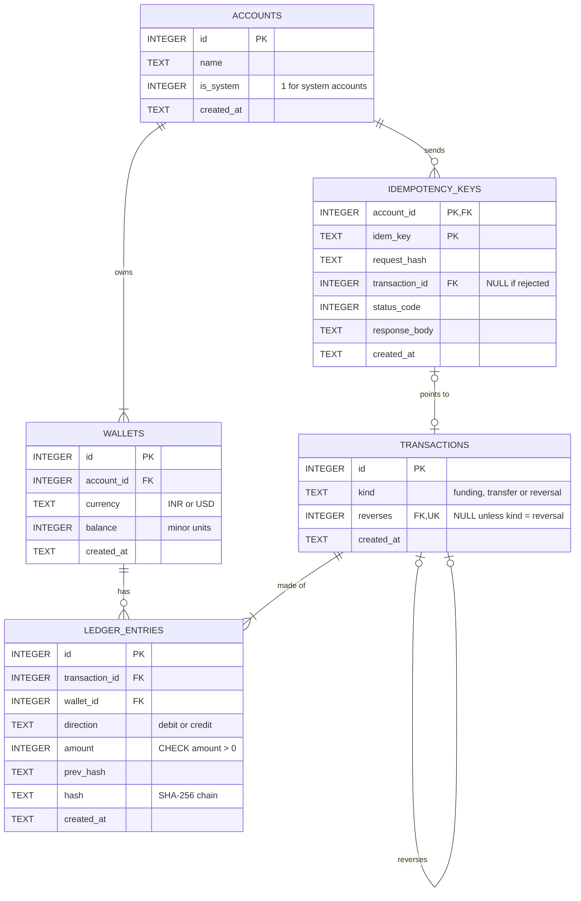
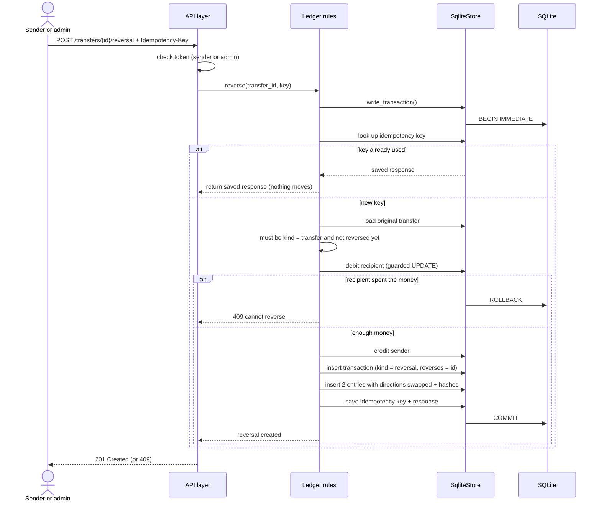
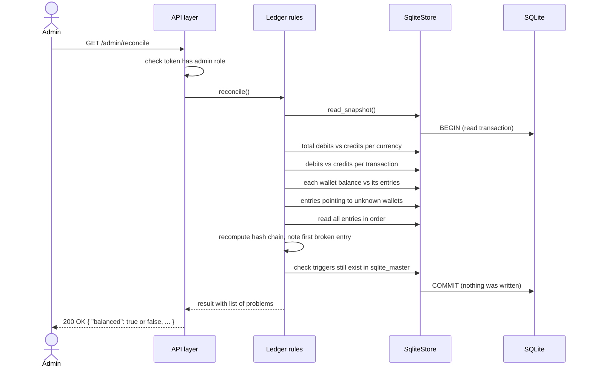

# Coinfidential Database Design

- **Author:** Aditya
- **Stage:** 2 (Design)
- **Requirements:** FR-1, FR-2, FR-3, FR-4, FR-5, SE-2
- **Based on:** the SRS, [architecture.md](architecture.md) and the ADRs in [docs/adr/](adr/)

This is the plan for the SQLite schema. Nothing here is built yet. All SQL will live in `app/storage/schema.sql` and only the storage layer will use it ([ADR-0006](adr/0006-storage-provider-interface.md)).

## 1. ER diagram



## 2. Tables

| Table | What it stores | Main rules |
| --- | --- | --- |
| `accounts` | A user, or a system account. | `is_system` is `0` or `1`. |
| `wallets` | One wallet per currency per account. | `UNIQUE(account_id, currency)`. `currency IN ('INR', 'USD')` ([ADR-0001](adr/0001-supported-currencies.md)). |
| `transactions` | One row per money movement. | `kind IN ('funding', 'transfer', 'reversal')`. `reverses` is `UNIQUE`, so a transfer can only be reversed once ([ADR-0002](adr/0002-no-partial-reversals.md)). |
| `ledger_entries` | The debit and credit lines of each transaction. | `direction IN ('debit', 'credit')`. `CHECK (amount > 0)`. Append-only (see section 4). |
| `idempotency_keys` | The saved result for each key a client sent. | `PRIMARY KEY (account_id, idem_key)`. Stores a hash of the request and the response we sent back (FR-2). |

Some general rules:

- All money is `INTEGER` in paise or cents. There are no `REAL` columns anywhere.
- We use **credit = money in** for wallets. A wallet's balance should always equal its credits minus its debits.
- `wallets.balance` is a cached number so we don't sum the whole ledger on every transfer. Reconciliation checks it against the ledger (FR-5.2).
- No `ON DELETE CASCADE` from wallets to ledger entries, because deleting a wallet is never a valid action.
- Access tokens get their own `tokens` table from [ADR-0005](adr/0005-token-format-and-lifetime.md). It is left out of the diagram to keep it small.

## 3. System accounts

There is one system account per currency: **System INR** and **System USD**. They are created when the database is set up.

When a user opens a wallet with a starting balance, we write a `funding` transaction: debit the system wallet, credit the user's wallet (FR-1.2, OD-3). This keeps the ledger balanced, because the money has to come from somewhere.

This means the system wallets go negative. They are the only wallets allowed to (BR-2). A `CHECK` can't look at another table, so this is enforced in the debit itself:

```sql
UPDATE wallets SET balance = balance - :amount
WHERE id = :wallet_id
  AND (balance >= :amount
       OR account_id IN (SELECT id FROM accounts WHERE is_system = 1));
```

If no row is updated, the wallet did not have enough money and the transaction is rolled back ([ADR-0004](adr/0004-begin-immediate-locking.md)).

## 4. Keeping the ledger append-only

Two triggers stop anyone from changing or removing a ledger entry (FR-4.1):

```sql
CREATE TRIGGER ledger_no_update BEFORE UPDATE ON ledger_entries
BEGIN SELECT RAISE(ABORT, 'ledger is append-only'); END;

CREATE TRIGGER ledger_no_delete BEFORE DELETE ON ledger_entries
BEGIN SELECT RAISE(ABORT, 'ledger is append-only'); END;
```

Things we learned in research that matter here:

- `INSERT OR REPLACE` gets past these triggers unless `PRAGMA recursive_triggers=ON` is set. It is per connection, so `SqliteStore` sets it on every connection together with WAL, `foreign_keys=ON`, `busy_timeout` and `synchronous=FULL`.
- `RAISE(ABORT)` only cancels the one statement, so our code must still `ROLLBACK` the whole transaction.
- Triggers can be dropped by anyone with database access. That is why each entry also has a hash chain, `hash = SHA-256(prev_hash + its own fields)`, and reconciliation recomputes it ([ADR-0003](adr/0003-tamper-detection.md)).

The same idea applies to `transactions`: it gets the same two triggers, since a reversal is a new row and never an edit.

## 5. Reversal

A reversal adds a new `reversal` transaction with the original entries flipped. The original rows are never touched. The full amount always goes back ([ADR-0002](adr/0002-no-partial-reversals.md)). Endpoint path is not final.



If two reversals of the same transfer race each other, `BEGIN IMMEDIATE` makes them wait in line, and `UNIQUE(reverses)` rejects the second one even if the code check was missed.

## 6. Reconciliation

Reconciliation only reads. It runs in one normal `BEGIN` read transaction, not `BEGIN IMMEDIATE`, so it sees one snapshot and does not block transfers (FR-5.3). In testing, running the queries separately gave false alarms in 254 of 300 runs. Endpoint path is not final.



Even when a problem is found we return `200`, because the check itself worked. An empty ledger has to count as balanced (`SUM` returns `NULL` there, so we use `COALESCE(SUM(...), 0)`).

## 7. Still open

- Whether `read_snapshot()` becomes a new method on `WalletStore`. ADR-0006 says to keep the interface small, so this should be agreed in the PR.
- How long to keep old idempotency keys. For now we keep them forever.
- Whether a reversal can itself be reversed. The plan above says no (only `kind = transfer` can be reversed), but there is no ADR for it yet.
